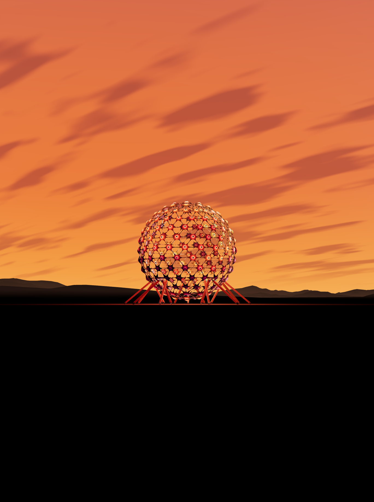
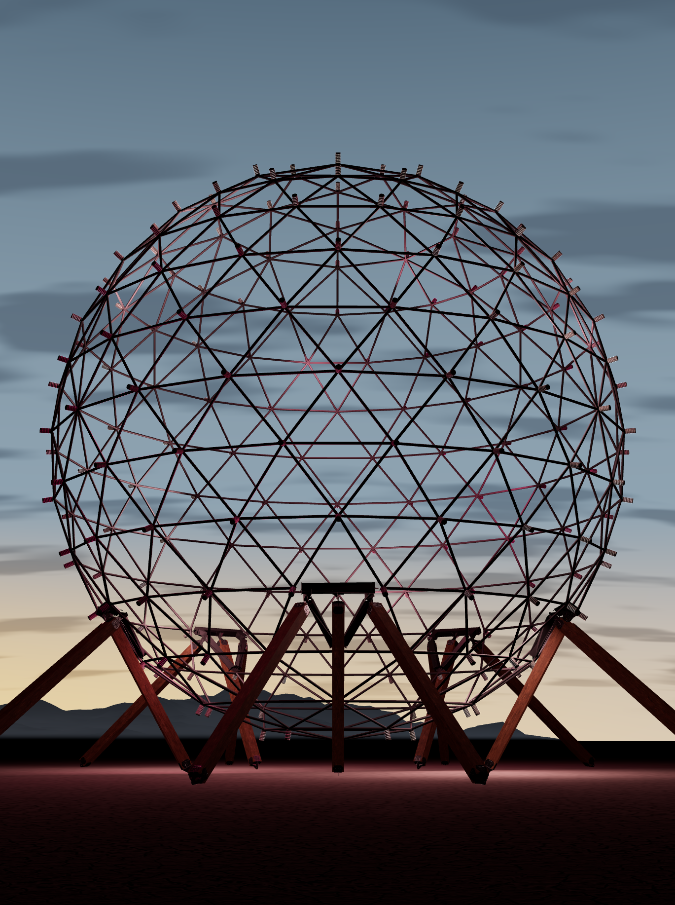
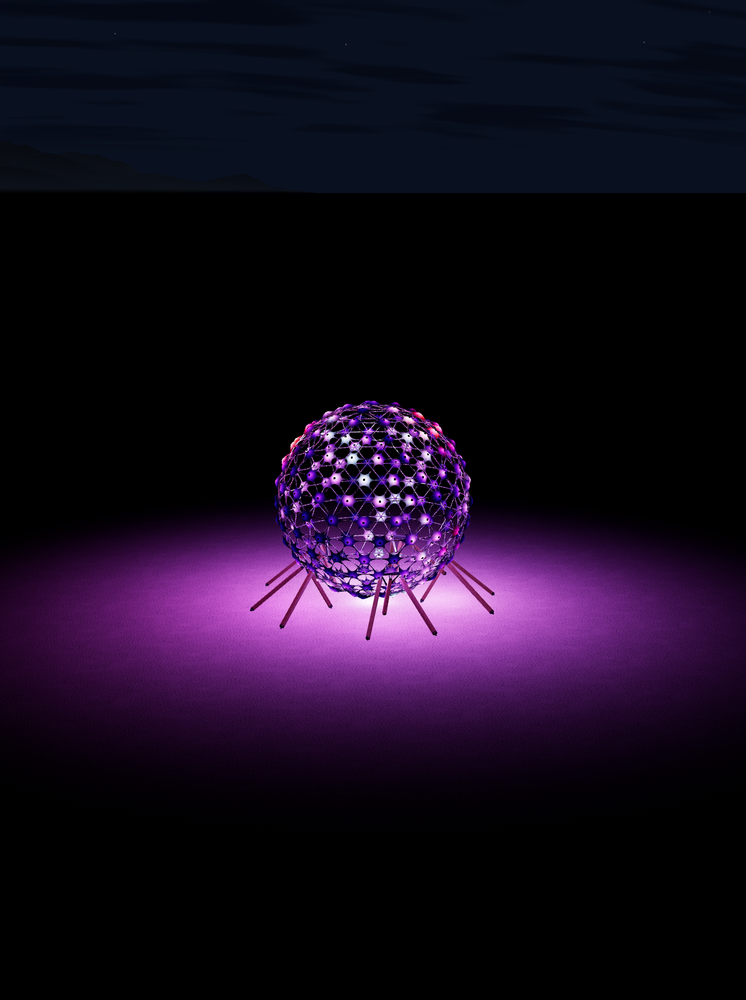
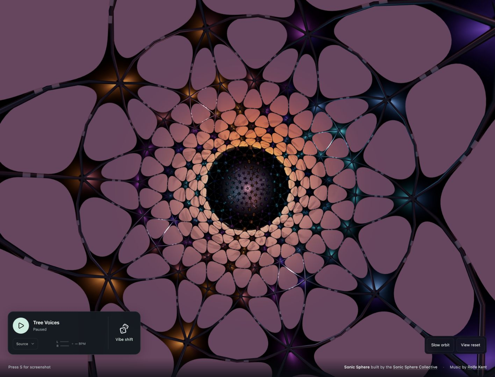

# Tiny Sphere

A 3D light and sound simulator for the Sonic Sphere at Burning Man.

I built this from the Sonic Sphere's original CAD model. The simulator includes its structure, underlying light tubes, and 25,440 individually modeled LEDs: 212 tubes with 120 LEDs each.

The surrounding terrain comes from real USGS topographic data covering a radius of 20 miles. I wrote a procedural texture generator to create a realistic, variegated playa floor.

The lighting scenes are inspired by some of my favorite moments at Burning Man.

The included music is Rolfe Kent's lovely *Tree Voices*, written specifically for the Sonic Sphere. You can also use other music by sharing a tab's audio in desktop Chrome.

I'd like to import our existing light and music shows so they can be replayed here. The code is organized so that others can add new looks, visual themes, and light shows.

I hope you enjoy it.

[Open the simulator](https://sonicsphere.github.io/TinySphere/).

For local setup and adding shows or themes, see [CONTRIBUTING.md](CONTRIBUTING.md). The physical installation was built by the [Sonic Sphere Collective](https://www.sonic-sphere.com/spheres/ka9-sonic-sphere). See [CREDITS.md](CREDITS.md) for the full credits.

Released under the [MIT license](LICENSE). Third-party components and media retain their credited rights and license notices; see [LICENSE-STATUS.md](LICENSE-STATUS.md).

## Screenshots

