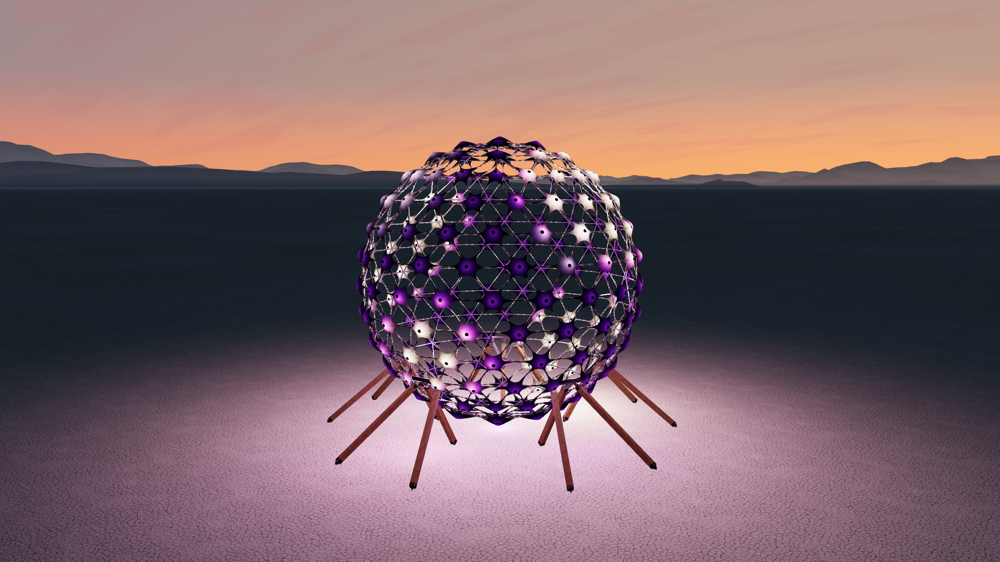
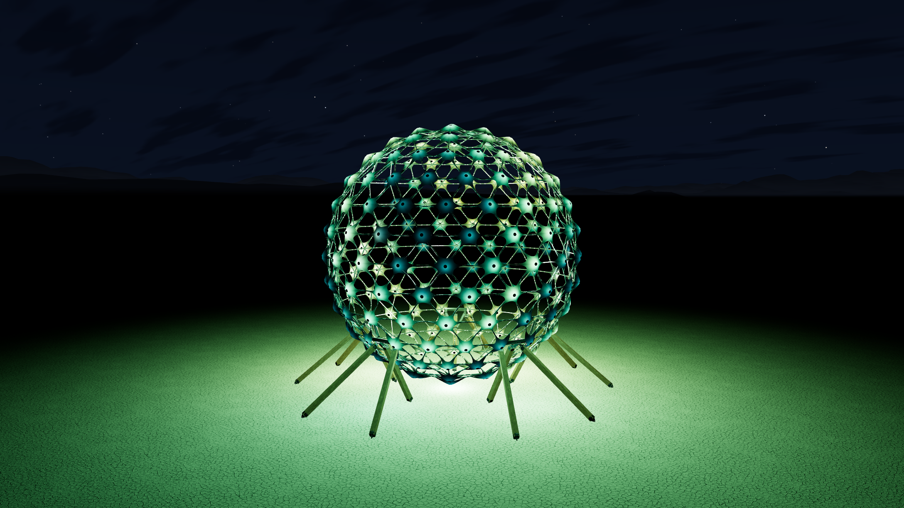
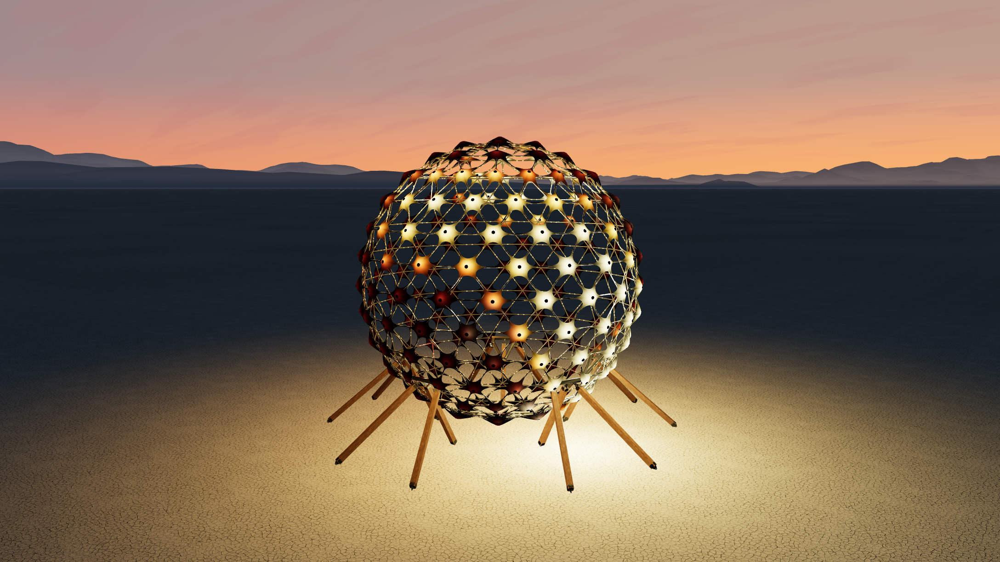
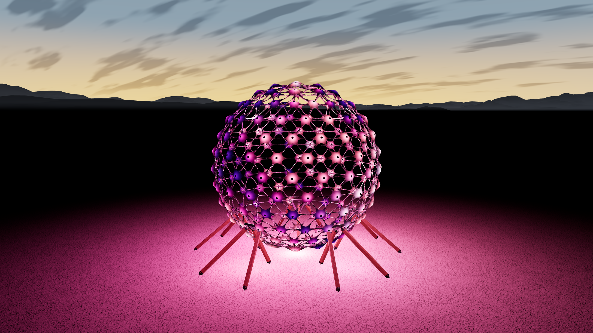
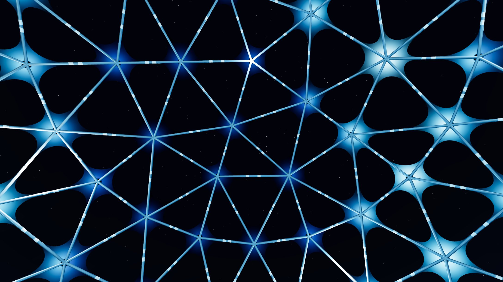

<p align="center"></p>
<h1 align="center">Tiny Sphere</h1>
<p align="center"><strong>A little world of light, color, and music.</strong></p>
<p align="center"><a href="https://sonic-sphere-light-studio.jebagu.chatgpt.site">Step inside ↗</a> · <a href="#make-it-yours">Make a light show</a> · <a href="CONTRIBUTING.md">Contribute</a></p>



Tiny Sphere brings the Sonic Sphere into your browser: a glowing, geometric world set on an open desert playa. Color flows across 212 fabric sails. Music becomes drifting light. You can circle the installation, pull back into the landscape, or travel all the way inside and look straight up.

It is also a place to make things. Write a new light show, compose a visual theme, or find a beautiful combination nobody has seen before. Shows and themes live in small JavaScript modules, with examples you can run and change.

The physical Sonic Sphere was built by the [Sonic Sphere Collective](https://www.sonic-sphere.com/spheres/ka9-sonic-sphere). The bundled music is **Tree Voices**, by [Rolfe Kent](https://www.instagram.com/musicbyrolfekent/).

## A sphere with many moods

<table>
  <tr>
    <td><br><strong>Aurora after dark</strong><br>Long ribbons, deep greens, open sky.</td>
    <td><br><strong>Honey hour</strong><br>Slow amber islands in the last light.</td>
  </tr>
  <tr>
    <td><br><strong>Velvet dawn</strong><br>Violet folds and electric blue.</td>
    <td><br><strong>From the inside</strong><br>Move into the center. Look in every direction.</td>
  </tr>
</table>

These are real captures from the app. [Settings and capture details](docs/screenshots.json) are included, along with a [visual introduction](docs/release.html).

## Run it locally

You need **Node.js 22 or later** and **Python 3.9 or later**. There are no npm packages to install.

```sh
npm run dev
```

Open **[http://127.0.0.1:4192/TinySphere/dist/](http://127.0.0.1:4192/TinySphere/dist/)**.

The port stays at 4192. If another server already uses it, stop that server or use the existing project server; the command will report the conflict. After editing source, run `npm run build` and refresh the browser.

Drag to look around. Scroll or pinch to move in and out. **Vibe shift** chooses a new combination of light, color, and sky. **Space** pauses the visuals. Music has its own play/pause control. Desktop Chromium browsers can also connect another music tab; the audio analysis stays in your browser.

## Make it yours

There are two contribution paths:

| You want to…           | Start here                                   | What you change                               |
| ---------------------- | -------------------------------------------- | --------------------------------------------- |
| Invent a new animation | [Add a light show](docs/adding-a-show.md)    | A function that samples light over the sphere |
| Compose a new mood     | [Add a visual theme](docs/adding-a-theme.md) | A show, palette, sky, and motion settings     |

Create a starter file:

```sh
npm run new:show -- my-show
# or
npm run new:theme -- my-theme
```

Add the new module to `src/shows/index.js` or `src/themes/index.js`, then run `npm run check`. The [contributor studio](http://127.0.0.1:4192/TinySphere/docs/playground.html) lets you audition every registered show and theme, hold a frame, explore the interior, and export an image.

You can also use the browser console:

```js
sphereStudio.applyTheme('aurora-after-dark');
sphereStudio.setLook('honey');
sphereStudio.setState({ palette: 'glacier', atmosphere: 'stars' });
```

See the [contribution guide](CONTRIBUTING.md), [architecture](docs/architecture.md), and [browser API](docs/api.md) for the rest.

## Find your way around

```text
src/
  shows/          Light-show modules and their registry
  themes/         Visual presets, palettes, and their registry
  engine/         Shared artwork, geometry, LEDs, and transitions
  audio/          Playback, capture, analysis worker, and worklet
  camera/         Orbit, gestures, and lens math
  environment/    Sky, mountains, playa, and light spill
  ui/             Controls, loading, and styles
  settings/       The selected arrival preset
  assets/         Model, terrain, textures, and music
  vendor/         Three.js and its license
examples/         Small, working contribution starters
tests/            Portable regression and content checks
scripts/          Build, preview server, and scaffolding
docs/             Guides, release introduction, and screenshots
assets/           Accepted geometry inputs used by the builder
```

The app uses native JavaScript modules and vendored Three.js. Python packages the static `dist/` directory, versions the whole module graph together, and prepares the accepted geometry. No framework, account, or server backend is required to run the experience.

## Check a change

```sh
npm run check
```

This builds the app, runs the tests, and checks the distribution and asset hashes. Coverage includes captured artwork references, every registered show and palette, theme validation, camera math, gestures, palette transitions, hardware shading, music startup, and the appearance wipe. Visual and audio changes also need a browser check; automated tests cannot judge how a show feels or sounds on a physical device.

To host the app, serve the contents of `dist/` as static files. It supports a subdirectory through relative asset URLs. The source folder and generated distribution are separate; local development pages are excluded from the app build.

## Credits and release status

This source snapshot includes the prepared 1.1 performance work and the approved camera, material, and branding revisions. The hosted demo can be on a different release. See [release notes](docs/release-notes.md).

**The release license is undecided.** No license is assigned to the original code in this preparation. Third-party licenses remain with their files; music and installation assets have separate provenance and permission records. See [license status](LICENSE-STATUS.md), [credits](CREDITS.md), and [asset provenance](src/asset-provenance.json).
